# SMUS CI/CD + Git V2 — End-to-End (Direct Deploy, Trunk-Based)

A developer commits through Git V2 in the SageMaker Unified Studio UI, opens a pull
request into `main`, and on merge one `deploy` command per stage promotes that commit
into the test and prod projects. No bundle archive. The git commit is the artifact.

This directory holds **only a manifest**. Every deployed file — notebooks, Query Books,
Visual ETL jobs, the workflow DAG — comes from a separate application repository that
the CLI clones at deploy time.

## Architecture

```mermaid
%%{init: {'theme': 'base', 'themeVariables': { 'primaryColor': '#e3f2fd', 'primaryTextColor': '#1a237e', 'primaryBorderColor': '#90caf9', 'lineColor': '#7986cb', 'secondaryColor': '#f3e5f5', 'tertiaryColor': '#e8f5e9', 'background': '#ffffff', 'clusterBkg': '#fafafa', 'clusterBorder': '#e0e0e0'}}}%%
flowchart LR
    subgraph DEV["SMUS Dev Project (Authoring)"]
        direction TB
        A1["Developer builds a notebook,<br/>Query Book or Visual ETL job"]
        A2["Git V2:<br/>Add to repository,<br/>Commit and Push"]
        A1 --> A2
    end

    subgraph GIT["Application Repository — GitHub (CodeConnections)"]
        direction TB
        B1["feature/* branch"]
        B2["main branch"]
        B1 -->|"Pull Request + review"| B2
    end

    subgraph CICD["CI/CD Pipeline (aws-smus-cicd-cli)"]
        direction TB
        C2["deploy --targets test<br/>clone → filter → copy → register"]
        C3["deploy --targets prod<br/>clone → filter → copy → register"]
        C2 -.->|"gate: approval"| C3
    end

    subgraph TEST["Test Project (Stage 1)"]
        T1["shared/Git-V2-test-repo-1/<br/>+ Airflow workflow"]
    end

    subgraph PROD["Prod Project (Stage 2)"]
        P1["shared/Git-V2-test-repo-1/<br/>+ Airflow workflow"]
    end

    A2 -->|"push via Git V2"| B1
    B2 -->|"merge triggers"| C2
    B2 -.->|"Git V2 pull<br/>keeps dev current"| A1
    C2 -->|"direct deploy"| T1
    C3 -->|"direct deploy"| P1

    classDef dev fill:#c8e6c9,stroke:#66bb6a,stroke-width:1.5px,color:#1b5e20
    classDef git fill:#e1bee7,stroke:#ab47bc,stroke-width:1.5px,color:#4a148c
    classDef cicd fill:#ffe0b2,stroke:#ffa726,stroke-width:1.5px,color:#e65100
    classDef test fill:#bbdefb,stroke:#42a5f5,stroke-width:1.5px,color:#0d47a1
    classDef prod fill:#f8bbd0,stroke:#ec407a,stroke-width:1.5px,color:#880e4f

    class A1,A2 dev
    class B1,B2 git
    class C2,C3 cicd
    class T1 test
    class P1 prod

    style DEV fill:#f1f8e9,stroke:#a5d6a7,stroke-width:2px
    style GIT fill:#f3e5f5,stroke:#ce93d8,stroke-width:2px
    style CICD fill:#fff8e1,stroke:#ffcc80,stroke-width:2px
    style TEST fill:#e3f2fd,stroke:#90caf9,stroke-width:2px
    style PROD fill:#fce4ec,stroke:#f48fb1,stroke-width:2px
```



`main` is the only deployment source. There is no branch per environment — the pull
request into `main` is the single review gate, and after merge the same commit walks
through test then prod.

| Role | Stage | Project | How it gets content |
| --- | --- | --- | --- |
| Source | `dev` | `gitv2-ml-dev` | Git V2 clone, developer pulls in the UI |
| Stage 1 | `test` | `gitv2-ml-test` | Deployed on merge to `main` |
| Stage 2 | `prod` | `gitv2-ml-prod` | Deployed after test passes, on approval |

**Dev is not a deploy target.** The Git V2 clone already holds the committed content
there. Deploying to dev would write a second copy of every file into the project people
are actively editing. The stage stays in the manifest so `describe` can target it.

## The Application Repository

[`Shnekit/Git-V2-test-repo-1`](https://github.com/Shnekit/Git-V2-test-repo-1) (private).
Its own README covers the artifact formats and per-type promotion caveats.

```text
notebooks/    ported-notebook.ipynb, sales-summary.ipynb
querybooks/   Query-book-for-git-v2.sqlnb
jobs/         VETL-for-git/{.vetl,.py,.json}
workflows/    sample_notebook_workflow.yaml, demo.yaml
README.md, .gitignore          ← not deployed
ported-notebook.ipynb          ← root duplicate, not deployed (see below)
```

`notebooks/` and `querybooks/` are an organizational convention this repository's
maintainer chose, not something Git V2 or the CLI requires. Git V2 always lands a
newly tracked artifact at the repository root — there is no folder picker in the SMUS
UI — so it's the manifest's `include` patterns that decide whether a file deploys, not
where it happens to sit. An exact root-level filename or a root-only glob in `include`
works exactly the same as pointing it at a subfolder; organizing into
`notebooks/`/`querybooks/` is only worth doing for your own repository hygiene, not
because the CLI needs it.

This repository's root `ported-notebook.ipynb` is a genuine duplicate of a notebook
later organised into `notebooks/`; anchoring to `notebooks/*.ipynb` keeps the manifest
from deploying both, which is why patterns are anchored rather than left bare.

`workflows/demo.yaml` is a minimal single-task DAG (one `EmptyOperator`) authored in the
studio's workflow editor; the `# {"Airflow-task":{...}}` comment on its first line is
that editor's canvas layout. It exists to show that a second workflow needs two
declarations, not one.

## How This Example Deploys

Each `deploy` call clones `content.git[].url`, applies this manifest's `include`/
`exclude` patterns, copies what survives into the target project, then runs
`workflow.create` to register the DAG. See [`docs/cli-commands.md`](../../docs/cli-commands.md)
for the full `deploy` command reference and what makes a git source exempt from
needing a bundle archive.

**For this example specifically:** the clone is a plain `git clone` with no
credential injection, so the private `Git-V2-test-repo-1` repository needs ambient
git credentials wherever you run `deploy` — a helper such as `gh auth login`
locally, or a token in the URL under CI. Never commit a token.

### Registering the workflow

Copying a DAG YAML to S3 leaves an inert file. Three pieces are needed, and the
manifest wires all three:

| Piece | Role |
| --- | --- |
| an `include` entry naming the YAML | Selects the DAG for copying |
| `content.workflows[]` | Declares `workflowName` + the connection that runs it |
| `bootstrap.actions: workflow.create` | **Registers the DAG.** Without this, nothing is created |

`deployment_configuration.workflows` exists in the schema but is not how creation
happens. `workflowName` must match the YAML's top-level key and its `dag_id`.

The `workflow.create` action takes an optional `workflowName`. This manifest omits it,
which registers every entry under `content.workflows`. Naming one workflow filters to
just that one and leaves the rest unregistered with no warning, so omit it unless you
specifically want a subset.

### Selecting files with `include`

Without `include` the whole repository is copied, `README.md` and all. See
[Git Repositories](../../docs/manifest.md#git-repositories) in the Manifest Guide
for the supported pattern forms and the `fnmatch` directory-separator caveat.

The manifest uses patterns for notebooks, Query Books and jobs so newly tracked
artifacts deploy without an edit, but names each workflow explicitly. A glob like
`workflows/*.yaml` would copy DAG YAML for workflows that are never registered, since
registration also needs a `content.workflows` entry — a file sitting in S3 doing
nothing.

So adding a workflow is a deliberate two-line change: one `include` entry and one
`content.workflows` entry. `demo.yaml` showed what happens when only the second is
there — `deploy` succeeded, registered `sample_notebook_workflow`, and printed

```text
⚠️ Workflow YAML not found for: demo
```

because `_find_dag_files_in_s3()` scans S3 for a YAML whose top-level key or `dag_id`
matches `demo`, and the file had never been copied. Declaring a workflow is not the same
as having one, and that warning is the only thing that tells you.

### Where files land

`default.s3_shared` resolves to
`s3://amazon-sagemaker-<account>-<region>-<projectId>/shared/`. In the dev project two
independent things live under it:

```text
shared/
├── repos/<gitConnectionId>/<repo>/<branch>/   ← Git V2 clone (managed by SMUS)
└── Git-V2-test-repo-1/                        ← where this example deploys
```

`targetDirectory` is named after the source repository so the deployed copy is
self-identifying and cannot be confused with the SMUS-managed clone. The DAG's
`input_path` values include this directory, so changing it means changing the DAG too.

Deploying puts objects in S3; it does **not** register them as project artifacts. The
notebooks appear under **Files**, and **Notebooks** stays empty until a user opens one.
The workflow is the exception — `workflow.create` registers it properly.

## Setup

Setting up the Git connection and pushing content is console-only and provider-generic —
follow [Git connections (admin guide)](https://docs.aws.amazon.com/sagemaker-unified-studio/latest/adminguide/git-connections.html)
and [Git repositories (user guide)](https://docs.aws.amazon.com/sagemaker-unified-studio/latest/userguide/working-with-repositories.html)
to create the connection, enable it for the project, add the repository to `dev`, and
track/push an artifact. (AWS documentation does not use the term "Git V2" — the
current experience is documented as Git repositories. Content was rephrased for
compliance with licensing restrictions.) Only `dev` needs the repository added; `test`
and `prod` receive deploys and never talk to git directly.

What's specific to running **this** example:

- **Domain and all three projects already exist** — the CLI cannot create domains, and project names must match `manifest.yaml`: `gitv2-ml-dev`, `gitv2-ml-test`, `gitv2-ml-prod`
- **Required connections on each project:** `default.s3_shared`, plus `default.workflow_serverless` on `test` and `prod`
- **Credentials:** AWS credentials, plus git credentials for the private `Git-V2-test-repo-1` application repository (see "How This Example Deploys" above)

> **The `domain.name` in `manifest.yaml` is a placeholder, not a constant.** Each
> stage hardcodes `name: Default_02092026_Domain` — that's whatever domain existed
> in the account this example was authored against. It will not match your domain
> unless you happen to have one by that exact name. Confirm your own domain name
> first:
> ```bash
> aws datazone list-domains --region us-east-1 --query 'items[].name' --output json
> ```
> and update all three `domain.name` entries in `manifest.yaml` (`dev`, `test`,
> `prod` stages) to match. `describe --connect` fails with `Domain not found` if
> this is wrong, and the error gives no hint that the fix is in the manifest rather
> than your credentials. If you switch AWS profiles/accounts between runs, re-check
> this — a domain name that was correct for one account/session can silently stop
> resolving in another.

> **Check for stray whitespace in project names.** The console renders a leading space
> invisibly, but DataZone stores it and the CLI's exact-match lookup then fails with
> `Project '<name>' not found`. Run
> `aws datazone list-projects --domain-identifier "$DOMAIN_ID" --query 'items[].name' --output json`
> — quoted names make stray spaces visible.

**Pipeline:** trigger on `push` to `main`, with one job per deploy stage
(`--targets test`, then `--targets prod` declaring `needs: [deploy-test]`). Put
required reviewers on the prod environment, give the runner read access to the
application repository, and protect `main` with a required pull request and review.
Ready-made pieces: `.github/workflows/smus-direct-deploy.yml` (reusable deploy + test
job) and `git-templates/direct-branch/standalone-application-workflow.yml`.

## Running It

Four commands, from the repository root. There is no runner script — one `deploy` call
does the whole job, and wrapping it would only hide that.

```bash
MANIFEST=examples/gitv2-end-to-end/manifest.yaml

aws-smus-cicd-cli describe --manifest "$MANIFEST" --targets test --connect
aws-smus-cicd-cli deploy   --manifest "$MANIFEST" --targets test --dry-run
aws-smus-cicd-cli deploy   --manifest "$MANIFEST" --targets test
aws-smus-cicd-cli monitor  --manifest "$MANIFEST" --targets test
```

> **⚠️ `$MANIFEST` is a shell variable, not persistent config.** It only exists for
> the rest of the current shell session. Pasting just one of the `aws-smus-cicd-cli`
> lines into a fresh terminal — without the `MANIFEST=...` line first, in that same
> session — sends an empty `--manifest ""` and fails with
> `Manifest validation failed for :` / `File not found: ` (both blank). Either run
> all four lines together, `echo "$MANIFEST"` to confirm it's still set before
> reusing it, or skip the variable and pass the path directly:
> `aws-smus-cicd-cli describe --manifest examples/gitv2-end-to-end/manifest.yaml --targets test --connect`.

### Environment variables

Nothing needs to be exported for a default run — the manifest's `${DEV_DOMAIN_REGION:us-east-1}`,
`${TEST_DOMAIN_REGION:us-east-1}` and `${PROD_DOMAIN_REGION:us-east-1}` references
each carry their own fallback. Set one only to target a region other than
`us-east-1` for that stage:

```bash
export TEST_DOMAIN_REGION=us-west-2
```

What the CLI does need, through its normal channels rather than a named variable:

- **AWS credentials** — your usual chain (profile, SSO, or OIDC in CI). Required for
  every DataZone/S3/Airflow call `deploy`/`describe`/`monitor` make.
- **Git credentials for the private `Git-V2-test-repo-1` repository** — `deploy`
  runs a plain `git clone` with no credential injection, so whatever already
  authenticates your `git` command (a credential helper, `gh auth login`, or a
  token embedded in the clone URL under CI) has to be in place beforehand.

Running via `.github/workflows/gitv2-end-to-end.yml` additionally needs these set
in the repo (as a secret and a variable, not plain env vars):

| Name | Kind | Used for |
| --- | --- | --- |
| `AWS_ROLE_ARN_TEST` | Secret | OIDC role the workflow assumes to deploy to `test` |
| `DOMAIN_REGION` | Variable | Region passed to `aws-actions/configure-aws-credentials` |

Swap `test` for `prod` to drive the other stage, though reaching prod from a workstation
defeats the review gate. `--targets dev` is for `describe` only.

`deploy` runs the dry-run validation itself and aborts before touching resources if it
finds errors, so the gate is on by default. `--skip-validation` bypasses it,
`--output json` machine-reads the report.

### Verified results

Deployed to test then prod against a real domain:

- **Filtering works** — `README.md`, `.gitignore` and the root duplicate notebook were excluded; only the files named by `include` were copied
- **Identical artifact bytes** in test and prod
- **Per-stage placeholder resolution** — the deployed workflow YAML carries each project's own `project_id`, `s3_bucket` and Glue `script_location`, from one committed file
- **Workflow `READY`** in both projects
- **Incremental on re-run** — unchanged objects skipped

That run predates `workflows/demo.yaml` being added to `include`, so it deployed 7 files
and registered one workflow while warning about `demo`. The current manifest selects 8
and declares both; the second workflow has not had a live run yet.

## Reference

- [`docs/cli-commands.md`](../../docs/cli-commands.md) — full command and flag reference
- [`examples/serverless-example/`](../serverless-example/) — the bundle flow, for content captured from a live project
- [`git-templates/direct-branch/standalone-application-workflow.yml`](../../git-templates/direct-branch/standalone-application-workflow.yml) — pipeline template
