# SMUS CI/CD + Git V2 — End-to-End (Direct Deploy, Trunk-Based)

A developer commits through Git V2 in the SageMaker Unified Studio UI, opens a pull
request into `main`, and on merge one `deploy` command per stage promotes that commit
into the test and prod projects. No bundle archive. The git commit is the artifact.

This directory holds **only a manifest**. Every deployed file — notebooks,
Visual ETL jobs, the workflow DAGs — comes from a separate application repository
that the CLI clones at deploy time.

## Architecture

```mermaid
%%{init: {'theme': 'base', 'themeVariables': { 'primaryColor': '#e3f2fd', 'primaryTextColor': '#1a237e', 'primaryBorderColor': '#90caf9', 'lineColor': '#7986cb', 'secondaryColor': '#f3e5f5', 'tertiaryColor': '#e8f5e9', 'background': '#ffffff', 'clusterBkg': '#fafafa', 'clusterBorder': '#e0e0e0'}}}%%
flowchart LR
    subgraph DEV["SMUS Dev Project (Authoring)"]
        direction TB
        A1["Developer builds a notebook<br/>or Visual ETL job"]
        A2["Git V2:<br/>Add to repository,<br/>Commit and Push"]
        A1 --> A2
    end

    subgraph GIT["Application Repository — GitHub (CodeConnections)"]
        direction TB
        B1["feature/* branch"]
        B2["main branch"]
        B1 -->|"Pull Request + review"| B2
    end

    subgraph CICD["CI/CD Pipeline (aws-smus-cicd-cli)"]
        direction TB
        C2["deploy --targets test<br/>clone → filter → copy → register"]
        C3["deploy --targets prod<br/>clone → filter → copy → register"]
        C2 -.->|"gate: approval"| C3
    end

    subgraph TEST["Test Project (Stage 1)"]
        T1["shared/Git-V2-test-repo-1/<br/>+ Airflow workflow"]
    end

    subgraph PROD["Prod Project (Stage 2)"]
        P1["shared/Git-V2-test-repo-1/<br/>+ Airflow workflow"]
    end

    A2 -->|"push via Git V2"| B1
    B2 -->|"merge triggers"| C2
    B2 -.->|"Git V2 pull<br/>keeps dev current"| A1
    C2 -->|"direct deploy"| T1
    C3 -->|"direct deploy"| P1

    classDef dev fill:#c8e6c9,stroke:#66bb6a,stroke-width:1.5px,color:#1b5e20
    classDef git fill:#e1bee7,stroke:#ab47bc,stroke-width:1.5px,color:#4a148c
    classDef cicd fill:#ffe0b2,stroke:#ffa726,stroke-width:1.5px,color:#e65100
    classDef test fill:#bbdefb,stroke:#42a5f5,stroke-width:1.5px,color:#0d47a1
    classDef prod fill:#f8bbd0,stroke:#ec407a,stroke-width:1.5px,color:#880e4f

    class A1,A2 dev
    class B1,B2 git
    class C2,C3 cicd
    class T1 test
    class P1 prod

    style DEV fill:#f1f8e9,stroke:#a5d6a7,stroke-width:2px
    style GIT fill:#f3e5f5,stroke:#ce93d8,stroke-width:2px
    style CICD fill:#fff8e1,stroke:#ffcc80,stroke-width:2px
    style TEST fill:#e3f2fd,stroke:#90caf9,stroke-width:2px
    style PROD fill:#fce4ec,stroke:#f48fb1,stroke-width:2px
```



`main` is the only deployment source. There is no branch per environment — the pull
request into `main` is the single review gate, and after merge the same commit walks
through test then prod.

| Role | Stage | Project | How it gets content |
| --- | --- | --- | --- |
| Source | `dev` | `gitv2-ml-dev` | Git V2 clone, developer pulls in the UI |
| Stage 1 | `test` | `gitv2-ml-test` | Deployed on merge to `main` |
| Stage 2 | `prod` | `gitv2-ml-prod` | Deployed after test passes, on approval |

**Dev is not a deploy target.** The Git V2 clone already holds the committed content
there. Deploying to dev would write a second copy of every file into the project people
are actively editing. The stage stays in the manifest so `describe` can target it.

## Implementing this example

### Step 1 — Prerequisites

- A SageMaker Unified Studio domain and three projects already created:
  `gitv2-ml-dev`, `gitv2-ml-test`, `gitv2-ml-prod` (or your own names, updated in
  the manifest — the CLI cannot create domains, so these must exist first).
- Each project has the connections this manifest needs: `default.s3_shared`
  everywhere, plus `default.workflow_serverless` on `test` and `prod`.
- An application repository on GitHub (or another provider supported by Git V2) to
  hold the deployed artifacts. This example uses a private repo,
  `Git-V2-test-repo-1`; use your own.
- AWS credentials for whichever account owns the domain, and git credentials for
  the application repository (a credential helper, `gh auth login`, or a token in
  the clone URL under CI — never commit a token).

### Step 2 — Connect the application repository to the dev project

Done once, in the SMUS console — this part is provider-generic and already
documented by AWS, so follow their guides rather than a re-explanation here:
[Git connections (admin guide)](https://docs.aws.amazon.com/sagemaker-unified-studio/latest/adminguide/git-connections.html)
and [Git repositories (user guide)](https://docs.aws.amazon.com/sagemaker-unified-studio/latest/userguide/working-with-repositories.html).
(AWS documentation calls this "Git repositories" rather than "Git V2." Content was
rephrased for compliance with licensing restrictions.)

1. Create the Git connection and enable it for the `dev` project.
2. Add your application repository to `dev`.
3. In the SMUS UI, build and track at least one artifact (a notebook or a
   Visual ETL job) through Git V2, then push it to `main`.

Only `dev` needs the repository added — `test` and `prod` receive deploys and
never talk to git directly.

### Step 3 — Write the manifest

This directory's `manifest.yaml` is the template; copy its structure for your own
repository. The parts that matter:

```yaml
content:
  git:
    - repository: Git-V2-test-repo-1       # must match deployment_configuration.git[].name
      url: https://github.com/Shnekit/Git-V2-test-repo-1.git
      include:
        - "*.ipynb"                        # which files from the repo actually deploy
        - jobs/**
        - workflows/sample_workflow.yaml   # workflow YAML must be listed explicitly
        - workflows/samplev2.yaml
  workflows:
    - workflowName: sample_workflow        # must match the YAML's top-level key / dag_id
      connectionName: default.workflow_serverless
    - workflowName: samplev2
      connectionName: default.workflow_serverless

stages:
  test:                                     # one block per stage: dev, test, prod
    domain:
      name: Default_02092026_Domain         # ⚠️ placeholder — see Step 4
      region: ${TEST_DOMAIN_REGION:us-east-1}
    project:
      name: gitv2-ml-test
      create: false
    bootstrap:
      actions:
        - type: workflow.create             # registers the DAGs; without this nothing is created
    deployment_configuration:
      git:
        - name: Git-V2-test-repo-1
          connectionName: default.s3_shared
          targetDirectory: Git-V2-test-repo-1
```

Three rules to keep in mind while writing your own version:

- **`include` and `content.workflows` must stay in sync.** A workflow YAML has to
  be both named in `include` (so it's copied) and declared under
  `content.workflows` (so it's registered) — one without the other either leaves
  an inert file in S3 or fails deploy outright. See "Adding a workflow" below.
- **`workflowName` must match the YAML's top-level key or its `dag_id`.** This is
  how `_find_dag_files_in_s3()` locates the file after it's copied.
- **`deployment_configuration.workflows` is not how registration happens** — only
  the `workflow.create` bootstrap action creates/updates the Airflow workflow.

### Step 4 — Point the manifest at your domain

**The `domain.name` in `manifest.yaml` is a placeholder, not a constant.** Each
stage hardcodes `name: Default_02092026_Domain` — whatever domain existed in the
account this example was authored against. Confirm your own domain name and
update all three `domain.name` entries (`dev`, `test`, `prod`) before running
anything:

```bash
aws datazone list-domains --region us-east-1 --query 'items[].name' --output json
```

`describe --connect` fails with `Domain not found` if this is wrong, and the error
gives no hint that the fix is in the manifest rather than your credentials. If you
switch AWS profiles/accounts between runs, re-check this — a domain name that
resolved for one account can silently stop resolving in another.

**Also check project names for stray whitespace.** The console renders a leading
space invisibly, but DataZone stores it, and the CLI's exact-match lookup then
fails with `Project '<name>' not found`. Run
`aws datazone list-projects --domain-identifier "$DOMAIN_ID" --query 'items[].name' --output json`
— quoted names make stray spaces visible.

### Step 5 — Run it

Four commands, from the repository root:

```bash
MANIFEST=examples/gitv2-end-to-end/manifest.yaml

aws-smus-cicd-cli describe --manifest "$MANIFEST" --targets test --connect
aws-smus-cicd-cli deploy   --manifest "$MANIFEST" --targets test --dry-run
aws-smus-cicd-cli deploy   --manifest "$MANIFEST" --targets test
aws-smus-cicd-cli monitor  --manifest "$MANIFEST" --targets test
```

`deploy` clones `content.git[].url`, applies `include`/`exclude`, copies what
survives into the target project's connection at `targetDirectory`, then runs the
stage's bootstrap actions to register the workflow. It also runs the dry-run
validation itself and aborts before touching resources if that validation finds
errors — the gate is on by default (`--skip-validation` bypasses it,
`--output json` machine-reads the report). See
[`docs/cli-commands.md`](../../docs/cli-commands.md) for the full command reference.

Swap `test` for `prod` to drive the other stage, though reaching prod from a
workstation defeats the review gate below. `--targets dev` is for `describe` only
— `dev` is never a deploy target.

**⚠️ `$MANIFEST` is a shell variable, not persistent config.** It only exists for
the rest of the current shell session. Pasting just one of the
`aws-smus-cicd-cli` lines into a fresh terminal — without the `MANIFEST=...` line
first, in that same session — sends an empty `--manifest ""` and fails with
`Manifest validation failed for :` / `File not found: ` (both blank). Either run
all four lines together, `echo "$MANIFEST"` to confirm it's still set before
reusing it, or skip the variable and pass the path directly.

Nothing needs to be exported for a default run — `${DEV_DOMAIN_REGION:us-east-1}`,
`${TEST_DOMAIN_REGION:us-east-1}` and `${PROD_DOMAIN_REGION:us-east-1}` each carry
their own fallback. Set one only to target a different region for that stage:

```bash
export TEST_DOMAIN_REGION=us-west-2
```

### Step 6 — Wire up CI/CD

This example only reacts to `deploy` being invoked — wiring that call to an actual
trigger (a push to `main`, a PR merge, a pipeline stage) is the caller's
responsibility, not something the example sets up by itself.
`.github/workflows/gitv2-end-to-end.yml` is the ready-made trigger for this
example: it runs on push to `main`/`test` touching this directory or `src/**`, and
deploys to `test` via the shared `smus-direct-deploy.yml` reusable workflow. It
needs these set in the GitHub repo (as a secret and a variable, not plain env
vars):

| Name | Kind | Used for |
| --- | --- | --- |
| `AWS_ROLE_ARN_TEST` | Secret | OIDC role the workflow assumes to deploy to `test` |
| `DOMAIN_REGION` | Variable | Region passed to `aws-actions/configure-aws-credentials` |

For your own pipeline: trigger on `push` to `main`, with one job per deploy stage
(`--targets test`, then `--targets prod` declaring `needs: [deploy-test]`). Put
required reviewers on the prod environment, give the runner read access to the
application repository, and protect `main` with a required pull request and
review. Ready-made pieces: `.github/workflows/smus-direct-deploy.yml` (reusable
deploy + test job) and
`git-templates/direct-branch/standalone-application-workflow.yml`.

## Reference: how the pieces fit together

### Adding a workflow

Copying a DAG YAML to S3 leaves an inert file. Three pieces are needed, and the
manifest wires all three:

| Piece | Role |
| --- | --- |
| an `include` entry naming the YAML | Selects the DAG for copying |
| `content.workflows[]` | Declares `workflowName` + the connection that runs it |
| `bootstrap.actions: workflow.create` | **Registers the DAG.** Without this, nothing is created |

The `workflow.create` action takes an optional `workflowName`. This manifest omits
it, which registers every entry under `content.workflows`. Naming one workflow
filters to just that one and leaves the rest unregistered with no warning, so omit
it unless you specifically want a subset.

Declaring a workflow in `content.workflows` without a matching `include` entry
fails deploy with:

```text
❌ Workflow YAML not found for: <workflowName>
```

because `_find_dag_files_in_s3()` scans S3 for a YAML whose top-level key or
`dag_id` matches `workflowName`, and the file was never copied. Declaring a
workflow is not the same as having one, and that error is the only thing that
tells you.

### Selecting files with `include`

Without `include` the whole repository is copied, `README.md` and all. See
[Git Repositories](../../docs/manifest.md#git-repositories) in the Manifest Guide
for the supported pattern forms and the `fnmatch` directory-separator caveat.

### Where files land

`default.s3_shared` resolves to
`s3://amazon-sagemaker-<account>-<region>-<projectId>/shared/`. In the dev project
two independent things live under it:

```text
shared/
├── repos/<gitConnectionId>/<repo>/<branch>/   ← Git V2 clone (managed by SMUS)
└── Git-V2-test-repo-1/                        ← where this example deploys
```

`targetDirectory` is named after the source repository so the deployed copy is
self-identifying and cannot be confused with the SMUS-managed clone. The DAG's
`input_path` values include this directory, so changing it means changing the DAG
too.

Deploying puts objects in S3; it does **not** register them as project artifacts.
The notebooks appear under **Files**, and **Notebooks** stays empty until a user
opens one. The workflow is the exception — `workflow.create` registers it
properly.

### Verified results

Deployed to `dev` and `test` against a real domain:

- **Filtering works** — only files matching `include` (`*.ipynb`, `jobs/**`, the
  two declared workflow YAML files) were copied; everything else in the
  repository (`README.md`, `.gitignore`) was excluded
- **Per-stage placeholder resolution** — the deployed workflow YAML carries each
  project's own `project_id`, `s3_bucket`, and connection values, from one
  committed file
- **Both workflows registered `READY`** (`sample_workflow`, `samplev2`) in both
  projects
- **Re-running `deploy`** updates an existing workflow in place rather than
  failing or duplicating it

The application repository's contents change independently of this manifest — a
workflow renamed or removed there without a matching `include`/`content.workflows`
update breaks `deploy` with `Workflow YAML not found`, as described above. Keep
the two in sync if you fork this example against your own repository.

## Reference

- [`docs/cli-commands.md`](../../docs/cli-commands.md) — full command and flag reference
- [`examples/serverless-example/`](../serverless-example/) — the bundle flow, for content captured from a live project
- [`git-templates/direct-branch/standalone-application-workflow.yml`](../../git-templates/direct-branch/standalone-application-workflow.yml) — pipeline template
